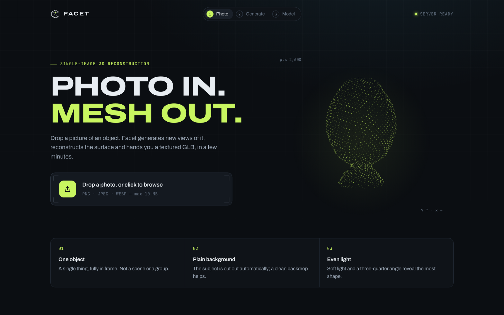
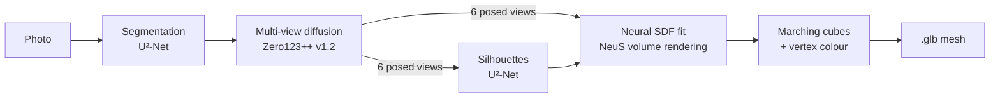

<div align="center">

# Facet: Image to 3D mesh

**One photo in, a textured 3D mesh out.**
A two-stage generative reconstruction pipeline (multi-view diffusion, then a neural signed distance field)
served by a production-style API, with a web app to drive it.

[](https://kareemwafaa.github.io/Image-to-3D-mesh/)

<!-- DEMO VIDEO: save a short recording as docs/media/demo.gif (or drag an .mp4 into a
     GitHub comment and paste the link here), then replace the image below. -->


</div>

## What it does

You upload a photo of a single object. Facet removes the background, asks a diffusion model to
imagine the object from six new viewpoints, fits a neural surface to those views by volume
rendering, and extracts a watertight, vertex-coloured mesh you can open in Blender, Unity or a
browser (`.glb`).



## Why it is built this way

A single image does not determine the back of an object, so the problem is ill-posed. Facet splits
it into two well-posed halves:

1. **Hallucinate, consistently.** Zero123++ (Shi et al., 2023) is Stable Diffusion fine-tuned to
   denoise six views of an object *on one canvas*. Self-attention spans the whole canvas, so the views
   agree with each other, and the cameras are fixed and known, so no pose estimation is needed.
2. **Reconstruct, with physics.** The surface is the zero level set of a signed distance function
   `f(x)`. NeuS (Wang et al., 2021) turns `f` into an *unbiased* volume renderer (the rendering weight
   peaks exactly at the surface), so `f` can be fitted to the six views by gradient descent:

   `L = L_rgb + 0.5 · L_mask + 0.1 · L_eikonal`

   Silhouette loss acts as a soft visual hull, and the Eikonal term `(‖∇f‖ − 1)²` keeps `f` a true
   distance field so the surface is clean. The field is a multi-resolution feature grid (Instant-NGP
   style) with finite-difference normals and a coarse-to-fine schedule (Neuralangelo).
3. **Extract.** Marching cubes on a 256³ grid gives a watertight mesh, coloured by querying the
   learned radiance field head-on.

The full derivations, design trade-offs (why not Gaussian splatting, why not a single feed-forward
network) and references are in [backend/README.md](backend/README.md#the-theory-stage-by-stage).

## System architecture

<!-- Owned by the backend work: API gateway, queue, GPU workers, storage, observability.
     The diagram and design decisions live in docs/architecture/. -->
The backend is built as a production-style service: an API gateway, a job queue, separate GPU
workers, object storage and metrics. See [docs/architecture/](docs/architecture/) for the system
diagram and the design decisions (ADRs). For free notebook GPUs it also runs in a single-process
"lite" mode.

## Results

> The pipeline has been verified end to end on CPU with synthetic scenes (see `backend/tests/`).
> GPU results go here after the first runs on a T4.

| Input | Six generated views | Mesh | Time on a T4 |
| --- | --- | --- | --- |
| *add a photo* | *add `views.png`* | *add a render or GIF* | *mm:ss* |

## Run it

The models need an NVIDIA GPU with roughly 12 GB of memory or more (the free T4 has 15 GB).
Pick one of three ways.

### 1. Free GPU on Colab or Kaggle

Open [`notebooks/facet_backend.ipynb`](notebooks/facet_backend.ipynb) in Google Colab or Kaggle,
switch on the T4 GPU (on Kaggle also switch *Internet* on), and *Run all*. The notebook installs the
backend, starts it on the GPU, opens a free Cloudflare tunnel and prints a link to the web app that
is already connected to your GPU.

### 2. Your own NVIDIA GPU (Linux or WSL)

```bash
git clone https://github.com/Kareemwafaa/Image-to-3D-mesh && cd Image-to-3D-mesh
bash scripts/setup_gpu_env.sh                       # pinned env in /tmp/facet-env
/tmp/facet-env/bin/python scripts/serve_public.py --no-tunnel
```

The API is then on `http://127.0.0.1:8000` (interactive docs at `/docs`). Drop `--no-tunnel` to
also get a public URL. Docker and the full multi-service setup are described in
[backend/README.md](backend/README.md#run-it).

### 3. Cloud GPU (optional)

The backend can also be deployed to [Modal](https://modal.com), which bills per second and scales
to zero. See [backend/README.md](backend/README.md#run-it).

### The web app

The frontend (Angular, in [`frontend/`](frontend/)) is a static site hosted on GitHub Pages:
**https://kareemwafaa.github.io/Image-to-3D-mesh/**. It can talk to any backend:

- click **Server** in the top-right corner and paste the backend URL, or
- add `?api=<backend URL>` to the page address (this is what the notebook's link does).

The choice is remembered in your browser.

## Repository layout

| Path | What is there |
| --- | --- |
| [`backend/`](backend/) | FastAPI service and the reconstruction pipeline, one module per stage |
| [`frontend/`](frontend/) | Facet, the Angular web app |
| [`notebooks/`](notebooks/) | Colab and Kaggle notebook for free GPUs |
| [`scripts/`](scripts/) | `setup_gpu_env.sh` (pinned environment) and `serve_public.py` (server + tunnel) |
| [`docs/`](docs/) | Architecture and screenshots |

## References

- Shi et al., *Zero123++: a Single Image to Consistent Multi-view Diffusion Base Model*, 2023.
- Wang et al., *NeuS: Learning Neural Implicit Surfaces by Volume Rendering for Multi-view Reconstruction*, NeurIPS 2021.
- Müller et al., *Instant Neural Graphics Primitives with a Multiresolution Hash Encoding*, SIGGRAPH 2022.
- Li et al., *Neuralangelo: High-Fidelity Neural Surface Reconstruction*, CVPR 2023.
- Gropp et al., *Implicit Geometric Regularization for Learning Shapes*, ICML 2020.
- Lorensen & Cline, *Marching Cubes*, SIGGRAPH 1987.
- Qin et al., *U²-Net: Going Deeper with Nested U-Structure for Salient Object Detection*, 2020.
