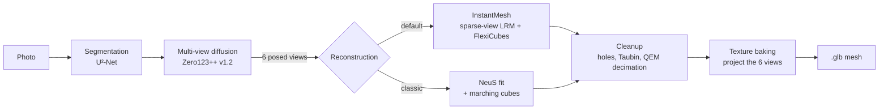

<div align="center">

# Facet: Image to 3D mesh

**One photo in, a textured 3D mesh out.**
A two-stage generative reconstruction pipeline (multi-view diffusion, then a neural signed distance field)
served by a production-style API, with a web app to drive it.

[](https://kareemwafaa.github.io/Image-to-3D-mesh/)

<!-- DEMO VIDEO: save a short recording as docs/media/demo.gif (or drag an .mp4 into a
     GitHub comment and paste the link here), then replace the image below. -->


</div>

## What it does

You upload a photo of a single object. Facet removes the background, asks a diffusion model to
imagine the object from six new viewpoints, reconstructs a 3D surface from those views, cleans it up
and paints it with a texture projected from the views. The result is a compact, textured mesh you can
open in Blender, Unity or a browser (`.glb`).



## Why it is built this way

A single image does not determine the back of an object, so the problem is ill-posed. Facet splits
it into two well-posed halves:

1. **Hallucinate, consistently.** Zero123++ (Shi et al., 2023) is Stable Diffusion fine-tuned to
   denoise six views of an object *on one canvas*. Self-attention spans the whole canvas, so the views
   agree with each other, and the cameras are fixed and known, so no pose estimation is needed.
2. **Reconstruct.** Two interchangeable reconstructors turn the six posed views into a surface:
   - **InstantMesh (default, seconds).** A Large Reconstruction Model (Xu et al., 2024): a DINO
     ViT encodes each view together with its camera, a transformer decodes the tokens into a
     *triplane* (three axis-aligned feature planes, a factorised 3D feature volume), and small MLPs
     read an SDF and colour at any point. FlexiCubes extracts the mesh; because that extraction is
     differentiable, the model was trained on rendered depth and normals of its own mesh, which is
     why its surfaces come out smooth. It learned a prior over shapes from ~270k objects, so small
     disagreements between the generated views are averaged away instead of carved into the surface.
   - **NeuS (classic, minutes).** Fits a signed distance function `f(x)` to the six views by
     gradient descent through an *unbiased* volume renderer (Wang et al., 2021):
     `L = L_rgb + 0.5 · L_mask + 0.1 · L_eikonal`. Silhouette loss acts as a soft visual hull and
     the Eikonal term `(‖∇f‖ − 1)²` keeps `f` a true distance field. Marching cubes extracts the mesh.
     Kept as a selectable mode so the two approaches can be compared on the same views.
3. **Clean up.** Floaters are removed, small holes closed, the surface Taubin-smoothed (a low-pass
   filter that does not shrink the object) and simplified with quadric error metrics to ~40k
   triangles, which keeps detail where the surface curves and makes the file about 10x smaller.
4. **Texture.** The mesh is UV-unwrapped (xatlas) and every texel is coloured by projecting it into
   the six views, using a z-buffer for visibility and weighting each view by `max(0, n·d)⁴`, so the
   camera that sees the surface most head-on wins. Unseen texels fall back to the model's colour.

Why InstantMesh became the default, with the theory and the measured problems of the NeuS-only
version, is in [ADR 0010](docs/architecture/adr/0010-instantmesh-texture-baking-cleanup.md).

The full derivations, design trade-offs (why not Gaussian splatting, why not a single feed-forward
network) and references are in [backend/README.md](backend/README.md#the-theory-stage-by-stage).

## System architecture

The pipeline runs inside a production-style job system, built to show how a
GPU service is put together, not just the model:

- **Gateway and workers.** A stateless FastAPI gateway never touches a GPU; it
  validates, rate-limits and enqueues. GPU workers pull jobs from a Redis
  Streams consumer group, so adding GPUs means starting more workers.
- **Reliability.** At-least-once delivery with idempotent consumers: leases
  and reclaim when a worker dies, retries with exponential backoff, a
  dead-letter queue with admin re-drive, per-job timeouts, and
  `Idempotency-Key` on submit. Postgres is the source of truth.
- **API.** Versioned REST, API keys, token-bucket rate limits, live progress
  over Server-Sent Events, RFC 9457 errors.
- **Observability.** Structured logs, Prometheus metrics with a provisioned
  Grafana dashboard, and OpenTelemetry traces that follow a job from the HTTP
  request, through the queue, into each GPU stage.
- **Two run modes, one code base.** `docker compose up` runs the full stack
  (Postgres, Redis, S3, workers, Prometheus, Grafana, Jaeger); `python -m app.lite`
  runs it all in one process on a free notebook GPU.


Diagrams, the failure-handling table and nine design decision records are in
[docs/architecture/](docs/architecture/README.md). CI runs the unit tests,
integration tests against real Postgres, Redis and S3, and a Docker Compose
smoke test on every pull request.

## Results

> The pipeline has been verified end to end on CPU with synthetic scenes (see `backend/tests/`).
> GPU results go here after the first runs on a T4.

| Input | Six generated views | Mesh | Time on a T4 |
| --- | --- | --- | --- |
| *add a photo* | *add `views.png`* | *add a render or GIF* | *mm:ss* |

## Run it

The models need an NVIDIA GPU with roughly 12 GB of memory or more (the free T4 has 15 GB).
Pick one of two ways.

### 1. Free GPU on Colab or Kaggle

Open [`notebooks/facet_backend.ipynb`](notebooks/facet_backend.ipynb) in Google Colab or Kaggle,
switch on the T4 GPU (on Kaggle also switch *Internet* on), and *Run all*. The notebook installs the
backend, starts it on the GPU, opens a free Cloudflare tunnel and prints a link to the web app that
is already connected to your GPU.

### 2. Your own NVIDIA GPU (Linux or WSL)

```bash
git clone https://github.com/Kareemwafaa/Image-to-3D-mesh && cd Image-to-3D-mesh
bash scripts/setup_gpu_env.sh                       # pinned env in /tmp/facet-env
/tmp/facet-env/bin/python scripts/serve_public.py --no-tunnel
```

The API is then on `http://127.0.0.1:8000` (interactive docs at `/docs`). Drop `--no-tunnel` to
also get a public URL. Docker and the full multi-service setup are described in
[backend/README.md](backend/README.md#run-it).


### The web app

The frontend (Angular, in [`frontend/`](frontend/)) is a static site hosted on GitHub Pages:
**https://kareemwafaa.github.io/Image-to-3D-mesh/**. It can talk to any backend:

- click **Server** in the top-right corner and paste the backend URL, or
- add `?api=<backend URL>` to the page address (this is what the notebook's link does).

The choice is remembered in your browser.

## Repository layout

| Path | What is there |
| --- | --- |
| [`backend/`](backend/) | API gateway, job queue, workers and the reconstruction pipeline, one module per stage |
| [`frontend/`](frontend/) | Facet, the Angular web app |
| [`notebooks/`](notebooks/) | Colab and Kaggle notebook for free GPUs |
| [`scripts/`](scripts/) | `setup_gpu_env.sh` (pinned environment) and `serve_public.py` (server + tunnel) |
| [`docs/`](docs/) | Architecture, design decisions (ADRs) and screenshots |
| [`deploy/`](deploy/), `docker-compose.yml` | The full stack: Prometheus, Grafana and S3 config, smoke test |

## References

- Shi et al., *Zero123++: a Single Image to Consistent Multi-view Diffusion Base Model*, 2023.
- Xu et al., *InstantMesh: Efficient 3D Mesh Generation from a Single Image with Sparse-view Large Reconstruction Models*, 2024.
- Hong et al., *LRM: Large Reconstruction Model for Single Image to 3D*, ICLR 2024.
- Shen et al., *Flexible Isosurface Extraction for Gradient-Based Mesh Optimization* (FlexiCubes), SIGGRAPH 2023.
- Wang et al., *NeuS: Learning Neural Implicit Surfaces by Volume Rendering for Multi-view Reconstruction*, NeurIPS 2021.
- Müller et al., *Instant Neural Graphics Primitives with a Multiresolution Hash Encoding*, SIGGRAPH 2022.
- Li et al., *Neuralangelo: High-Fidelity Neural Surface Reconstruction*, CVPR 2023.
- Gropp et al., *Implicit Geometric Regularization for Learning Shapes*, ICML 2020.
- Lorensen & Cline, *Marching Cubes*, SIGGRAPH 1987.
- Taubin, *A Signal Processing Approach to Fair Surface Design*, SIGGRAPH 1995.
- Garland & Heckbert, *Surface Simplification Using Quadric Error Metrics*, SIGGRAPH 1997.
- Qin et al., *U²-Net: Going Deeper with Nested U-Structure for Salient Object Detection*, 2020.
