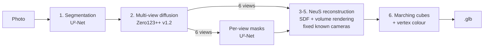

# Image to 3D mesh: backend

A service that turns one photo of an object into a textured 3D mesh (`.glb`).
It is a two-stage generative reconstruction pipeline: a diffusion model
imagines the unseen sides of the object, then a neural signed distance field
is optimised to agree with those views, and marching cubes extracts the surface.



| Stage | Module | Method |
| --- | --- | --- |
| 1 | `app/pipeline/segmentation.py` | U²-Net salient object segmentation (rembg), crop and centre |
| 2 | `app/pipeline/multiview.py` | Zero123++ v1.2: six consistent novel views from one image |
| 3 | `app/pipeline/cameras.py` | The six fixed camera poses, pixel rays |
| 4 | `app/pipeline/neus.py` | NeuS neural SDF, multi-resolution grid encoding, unbiased volume rendering |
| 5 | `app/pipeline/reconstruct.py` | Per-object optimisation with RGB, silhouette and Eikonal losses |
| 6 | `app/pipeline/meshing.py` | Marching cubes, floater removal, vertex colours, glTF export |

The web API (`app/main.py`) and job queue (`app/jobs.py`) wrap the pipeline;
`modal_app.py` deploys it on [Modal](https://modal.com) GPUs.

## The theory, stage by stage

### 1. Segmentation

The photo's background would otherwise be reconstructed as geometry, so we
segment the object with **U²-Net** (Qin et al., 2020), a nested U-Net whose
residual U-blocks capture multi-scale context for salient object detection.
The result is cropped to the object's bounding box, padded to a square and
scaled so the object fills 85% of the frame, which matches what the diffusion
model saw in training. The same segmenter later gives a silhouette mask for
each generated view.

### 2. Multi-view diffusion (Zero123++)

A single image does not determine the back of an object: the problem is
ill-posed. We resolve the ambiguity with a learned prior. **Zero123++**
(Shi et al., 2023) is Stable Diffusion fine-tuned on renders of Objaverse
objects to produce six views of the input object at fixed poses.

- **One canvas, six views.** The six 320×320 views are tiled into one 960×640
  image and denoised *jointly*. Self-attention spans the whole canvas, so the
  views exchange information at every denoising step, which is what makes them
  geometrically consistent. (Its predecessor, Zero-1-to-3, sampled each view
  independently, and the views disagreed with each other.)
- **Two kinds of conditioning.** Global: CLIP image embedding through
  cross-attention. Local: *reference attention*, where the UNet also processes
  the (noised) input image and its self-attention keys and values are
  concatenated into those of the canvas, so fine appearance details transfer.
- **Fixed poses.** v1.2 outputs azimuths 30°, 90°, …, 330° relative to the
  input, at alternating absolute elevations +20° and −10°, with a 30° field of
  view and a normalised object scale. Because these poses are known, we need
  no structure-from-motion or pose estimation.
- Sampling uses the Euler-ancestral sampler with "trailing" timestep spacing,
  75 steps by default (the authors note 28 suffice for coarse results).

### 3. Cameras

Each view gets a pinhole camera on a sphere of radius 4 looking at the origin
(OpenGL convention, z-up world). Every pixel then defines a ray
`r(t) = o + t·d`. With six views at 320² this gives 614,400 supervised rays.

### 4. Neural SDF and unbiased volume rendering (NeuS)

The shape is the zero level set of a **signed distance function**
`f: ℝ³ → ℝ` (negative inside, positive outside), represented by a neural
field. Optimising it from images needs a differentiable renderer. Plain NeRF
learns a density, which gives no well-defined surface; naively converting an
SDF to a density gives a rendering weight that peaks *in front of* the
surface (biased). **NeuS** (Wang et al., 2021) derives a density that is
unbiased:

- Let `Φ_s(x) = sigmoid(s·x)` be the logistic CDF with sharpness `s`. Define the
  opaque density along a ray as
  `ρ(t) = max(−(dΦ_s(f(r(t)))/dt) / Φ_s(f(r(t))), 0)`.
  Then the weight `w(t) = T(t)·ρ(t)` (with transmittance `T`) has its maximum
  exactly where the ray meets the surface, and it accounts for occlusion.
- Discretised over a ray section `[t_i, t_{i+1}]`:
  `α_i = max((Φ_s(f_i) − Φ_s(f_{i+1})) / Φ_s(f_i), 0)`, and the pixel colour is
  `Σ_i T_i α_i c_i` with `T_i = Π_{j<i}(1 − α_j)`.
- `s` is learned (`s = exp(10·v)`). `1/s` acts as the surface "thickness":
  large at first so gradients reach far, it shrinks as the fit improves.
- **Hierarchical sampling.** 64 uniform samples per ray, then 64 more placed by
  inverse-transform sampling where a sharpened copy of the current SDF (fixed
  `s = 64·2^k` over 4 rounds) predicts the surface.

**Field architecture.** Following Instant-NGP (Müller et al., 2022), the input
point is encoded by trilinear interpolation into six dense 3D feature grids at
resolutions 16 to 128 (geometric progression), concatenated with the raw
coordinates and passed to a 2-layer MLP (64 units, Softplus). The MLP predicts
an SDF *residual* on top of a sphere of radius 0.5, so optimisation starts from
a valid SDF. A second small MLP predicts colour from position, normal, view
direction and a 15-dimensional geometry feature.

**Normals by finite differences.** The normal is `∇f`. As in Neuralangelo
(Li et al., 2023) we take it by central differences with a step tied to the
finest active grid cell. With grid encodings, analytic gradients are only
locally (per-cell) supported; numerical gradients spread the Eikonal signal
across neighbouring cells and give smoother surfaces. (They also avoid
second-order derivatives of `grid_sample`, which PyTorch does not implement.)

### 5. Optimisation

For each request we fit a fresh field (test-time optimisation, about 2,500
steps of 1,024 random rays, Adam with warm-up and cosine decay):

`L = L_rgb + 0.5·L_mask + 0.1·L_eik`

- `L_rgb`: L1 between the rendered colour and the generated view, composited on
  white with its mask.
- `L_mask`: binary cross-entropy between rendered opacity `Σ_i w_i` and the
  silhouette. With only six views, silhouettes are the strongest geometric
  signal; this is a soft, differentiable form of visual-hull carving.
- `L_eik = E[(‖∇f‖ − 1)²]` at ray samples and random points: the Eikonal
  equation holds for true distance functions (Gropp et al., 2020), so this keeps
  `f` an SDF and its zero set a clean surface.

Two schedules make this robust to sparse, slightly inconsistent views:
**coarse-to-fine** (Neuralangelo) unlocks the fine grid levels gradually over
the first half of training, so the overall shape forms before detail; and
**cosine annealing** (NeuS) moves the section-SDF estimate from a smoothed to
the exact form over the first 20%.

### 6. Mesh extraction

**Marching cubes** (Lorensen & Cline, 1987) evaluates `f` on an N³ grid
(`mc_resolution`, 256 by default). In each cell whose corners change sign it
emits triangles from a case table (256 sign patterns, 15 up to symmetry),
placing vertices on edges by linear interpolation of `f`. Because `f` is a
distance, interpolation is accurate and the output is watertight. We then
drop disconnected pieces under 5% of the largest one's area (floaters), make
the faces point along `∇f`, colour each vertex by querying the colour field
head-on (view direction `−n`), rotate to glTF's y-up frame and export `.glb`.

### Why NeuS and not Gaussian splatting?

3D Gaussian splatting (Kerbl et al., 2023) optimises much faster, but it
represents a *radiance* field with no explicit surface. Getting a mesh needs
extra machinery (SuGaR, 2D Gaussian splatting) and is fragile with only six
views. An SDF has the surface built in, the Eikonal prior regularises the
sparse-view problem, and marching cubes gives a watertight mesh directly.

### Why not one feed-forward network?

Feed-forward reconstructors (TripoSR, LRM, InstantMesh's LRM) answer in about
a second, but are limited to what one network pass can represent. The
optimisation-based second stage here is slower (minutes) but its result is
fitted to the specific object, is easy to inspect (you can see the six views
it was fitted to), and each stage is replaceable. TripoSR is kept as a
baseline (`MODEL_BACKEND=triposr`) for comparisons.

## What has been verified, and what are guesses

Verified here (CPU, see `tests/`): the API end to end with a mock model; the
camera geometry; the NeuS renderer, optimiser and mesher, which recover
synthetic scenes rendered from the six Zero123++ cameras (an off-centre sphere
in the test suite; two coloured spheres at 64 px and 400 steps reached a mean
surface error of 0.018 with correct colours).

Not run yet, because this environment has no GPU and cannot reach Hugging Face:

- **Zero123++ inference and the Modal deployment** have not been run. The code
  follows the authors' README and pipeline source (diffusers 0.20.2).
- **GUESS: camera radius 4.0** (from InstantMesh). Zero123++ only states a
  "normalised object size". A wrong radius rescales the object; it does not
  distort it.
- **GUESS: azimuth direction.** Counter-clockwise seen from +z, as in InstantMesh.
  If generated views come out mirrored relative to the cameras, the reconstruction
  will be poor; flipping the sign of `ZERO123PP_AZIMUTHS` fixes it.
- **GUESS: timings.** Roughly 10-20 s for diffusion and 1-3 min for
  reconstruction on an A10G. Lower `recon_iters` or `diffusion_steps` for speed.
- **GUESS: hyperparameters** (`ReconConfig`) were chosen by reasoning and
  synthetic tests, not tuned on real generated views.

## API

| Method | Path | What it does |
| --- | --- | --- |
| `POST` | `/generate` | Multipart upload. Returns `202 {"job_id": "..."}` |
| `GET` | `/jobs/{job_id}` | Job status (see below) |
| `GET` | `/jobs/{job_id}/result` | The mesh, `model/gltf-binary`. 404 until ready, 409 if the job failed |
| `GET` | `/jobs/{job_id}/views` | The six generated views as one 3×2 PNG, once stage 2 is done |
| `GET` | `/health` | Backend name, model status, queue size |

Interactive docs are served at `/docs`.

`POST /generate` form fields (all optional except `image`):

| Field | Default | Range | Notes |
| --- | --- | --- | --- |
| `image` | | | PNG, JPEG or WebP, up to 10 MB |
| `remove_background` | `true` | | `false` if the image already has transparency |
| `foreground_ratio` | `0.85` | 0.5 to 1.0 | How much of the frame the object fills |
| `mc_resolution` | `256` | 32 to 512 | Marching cubes grid. Higher means finer mesh |
| `diffusion_steps` | `75` | 10 to 150 | Zero123++ denoising steps |
| `recon_iters` | `2500` | 100 to 20000 | NeuS optimisation steps |
| `seed` | random | | Fix it for reproducible views |

`GET /jobs/{job_id}`:

```json
{
  "job_id": "3f2c...",
  "status": "running",
  "stage": "reconstructing",
  "progress": 0.62,
  "result_url": null,
  "views_url": "/jobs/3f2c.../views",
  "error": null,
  "created_at": "2026-11-25T19:00:00+00:00",
  "updated_at": "2026-11-25T19:01:10+00:00"
}
```

`status` is `queued`, `running`, `succeeded` or `failed`. `stage` is
`segmenting`, `multiview`, `segmenting_views`, `reconstructing`, `meshing`,
then `done`. URLs are relative to the API's base URL.

```bash
JOB=$(curl -s -F image=@chair.jpg $API/generate | jq -r .job_id)
curl -s $API/jobs/$JOB
curl -o chair.glb $API/jobs/$JOB/result
```

## Run it

### Development, no GPU

The `mock` backend returns a coloured cube, so the API and frontend can be
built anywhere.

```bash
cd backend
python -m venv .venv && . .venv/bin/activate
pip install -r requirements-dev.txt
MODEL_BACKEND=mock uvicorn app.main:app --reload
pytest            # ~1-2 min; the NeuS test trains a tiny model on CPU
```

### Free GPU: Colab or Kaggle notebook

The easiest way to run the real pipeline. The notebook in
[`notebooks/facet_backend.ipynb`](../notebooks/facet_backend.ipynb) installs a pinned environment
(`scripts/setup_gpu_env.sh`), starts the API on the free T4 and exposes it through a Cloudflare quick
tunnel (`scripts/serve_public.py`).

### Deploy on Modal (optional)

```bash
pip install modal && modal setup
cd backend
CORS_ORIGINS=https://your-frontend.example modal deploy modal_app.py
```

This creates a CPU web endpoint for the API and a GPU class (`MeshWorker`, A10G
by default) that scales to zero when idle, with Zero123++ and U²-Net weights
baked into its image. Job state lives in a `modal.Dict` and files in a
`modal.Volume`; a scheduled function deletes jobs after 24 hours. Settings at
deploy time: `MODAL_GPU` (e.g. `L4`, `A100`), `MODAL_MAX_GPUS` (cost cap,
default 2), `CORS_ORIGINS`, `JOB_TTL_HOURS`.
Use `modal serve modal_app.py` for a live-reloading dev deployment.

### Your own GPU machine (Docker)

```bash
docker build -t image-to-3d-api backend/
docker run --gpus all -p 8000:8000 -v $PWD/data:/data image-to-3d-api
```

Here jobs run in a thread inside the API process, one at a time.

## Configuration (local and Docker)

| Variable | Default | Meaning |
| --- | --- | --- |
| `MODEL_BACKEND` | `multiview` | `multiview`, `triposr` (baseline) or `mock` |
| `DEVICE` | `auto` | `cuda`, `cpu` or `auto` |
| `CORS_ORIGINS` | `http://localhost:3000,http://localhost:4200` | Comma-separated allowed origins, or `*` for any (the API uses no cookies) |
| `DATA_DIR` | `./data` | Where inputs, views and meshes are stored |
| `MAX_UPLOAD_MB` | `10` | Upload limit |
| `JOB_TTL_HOURS` | `24` | Finished jobs are deleted after this; `0` keeps them |
| `PRELOAD_MODEL` | `true` | Load models at start-up instead of on the first job |
| `DIFFUSION_STEPS`, `RECON_ITERS`, `MC_RESOLUTION`, `FOREGROUND_RATIO` | | Defaults for the form fields above |

## Next steps worth doing

- **Evaluate quantitatively.** Chamfer distance and volume IoU against ground
  truth on Google Scanned Objects, comparing this pipeline with the TripoSR
  baseline. This turns the project from a demo into a result.
- Estimate the input view's elevation and add it as a seventh supervised view.
- Use Zero123++'s normal-generation ControlNet for normal supervision and
  cleaner masks.
- Texture: UV-unwrap (xatlas) and bake the colour field into a texture image
  instead of per-vertex colours.
- Mesh decimation (quadric error metrics) to shrink the `.glb`.

## References

- Shi et al., *Zero123++: a Single Image to Consistent Multi-view Diffusion Base Model*, 2023.
- Liu et al., *Zero-1-to-3: Zero-shot One Image to 3D Object*, ICCV 2023.
- Wang et al., *NeuS: Learning Neural Implicit Surfaces by Volume Rendering for Multi-view Reconstruction*, NeurIPS 2021.
- Müller et al., *Instant Neural Graphics Primitives with a Multiresolution Hash Encoding*, SIGGRAPH 2022.
- Li et al., *Neuralangelo: High-Fidelity Neural Surface Reconstruction*, CVPR 2023.
- Gropp et al., *Implicit Geometric Regularization for Learning Shapes*, ICML 2020.
- Mildenhall et al., *NeRF: Representing Scenes as Neural Radiance Fields for View Synthesis*, ECCV 2020.
- Lorensen & Cline, *Marching Cubes: A High Resolution 3D Surface Construction Algorithm*, SIGGRAPH 1987.
- Qin et al., *U²-Net: Going Deeper with Nested U-Structure for Salient Object Detection*, Pattern Recognition 2020.
- Kerbl et al., *3D Gaussian Splatting for Real-Time Radiance Field Rendering*, SIGGRAPH 2023.
- Xu et al., *InstantMesh: Efficient 3D Mesh Generation from a Single Image with Sparse-view Large Reconstruction Models*, 2024.
- Tochilkin et al., *TripoSR: Fast 3D Object Reconstruction from a Single Image*, 2024.
