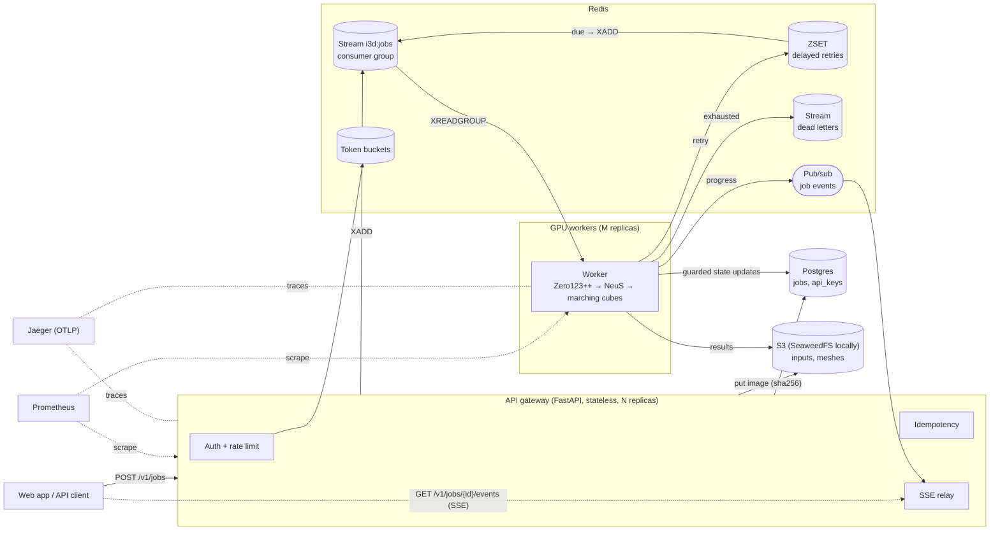
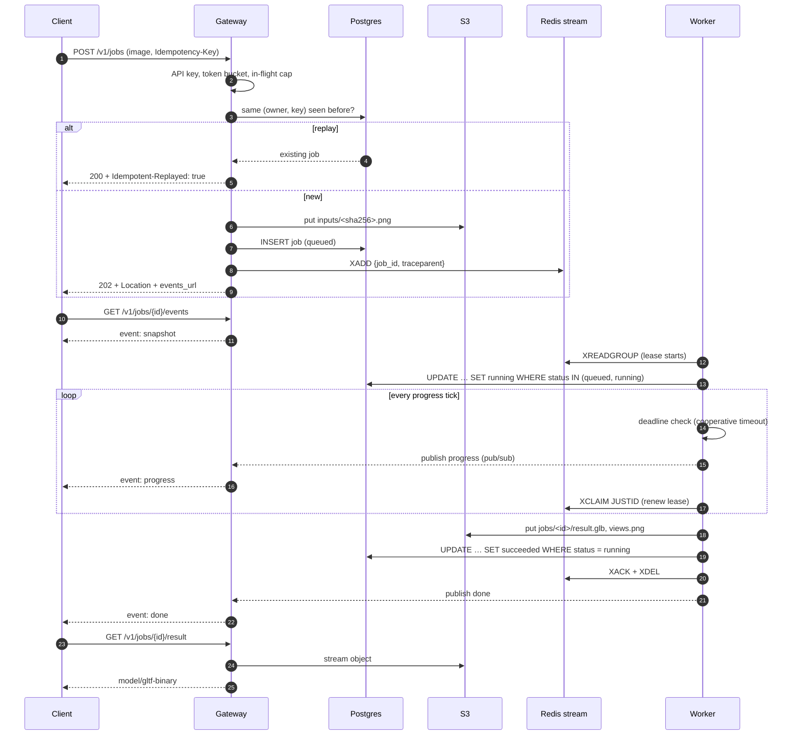
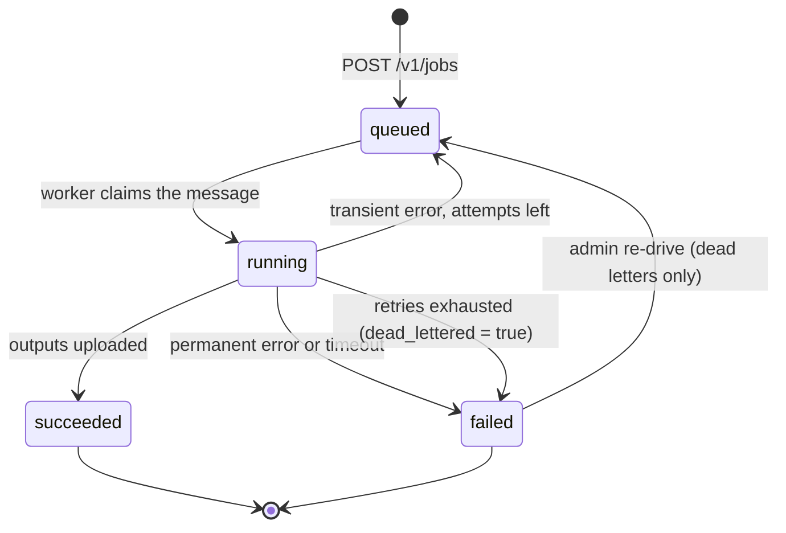
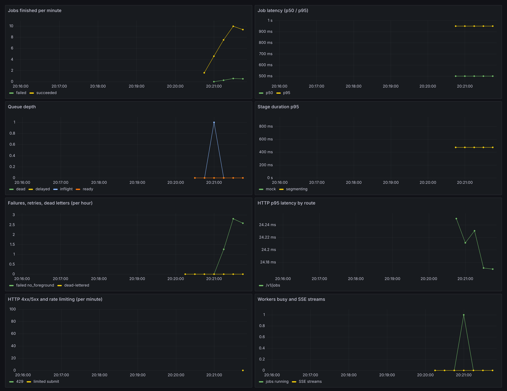
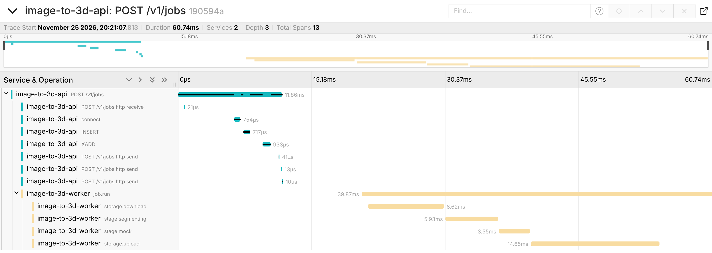

# System architecture

The backend is a small distributed system built around one scarce resource:
GPU time. A stateless API gateway accepts work, a durable queue hands it to
GPU workers, Postgres records what happened, and object storage holds the
files. The same code runs as a full stack (`docker compose up`) or as a
single process on one free notebook GPU (`python -m app.lite`).

- [Components](#components)
- [Life of a job](#life-of-a-job)
- [Job state machine](#job-state-machine)
- [Failure handling](#failure-handling)
- [API](#api)
- [Observability](#observability)
- [Run modes](#run-modes)
- [Code map](#code-map)
- [Scaling path](#scaling-path)
- [Decision records](#decision-records)

## Components



| Component | Responsibility | State |
| --- | --- | --- |
| Gateway (`app/api`, `app/services`) | Validate, authenticate, rate-limit, deduplicate, store the input, enqueue, serve status, SSE and files | None (any replica can serve any request) |
| Queue (`app/jobqueue`) | Deliver each job to one worker at a time, with leases, retries and dead letters | Redis stream, delayed ZSET, dead-letter stream |
| Worker (`app/worker`) | Run the ML pipeline, report progress, record the outcome | The loaded models only |
| Job store (`app/db`) | Source of truth for every job and API key | Postgres (SQLite in lite mode) |
| Object storage (`app/storage`) | Inputs (content-addressed) and outputs (per job) | Any S3: SeaweedFS locally, AWS/R2/B2 in production (local disk in lite mode) |
| Event bus (`app/bus`) | Progress fan-out and worker heartbeats | Redis pub/sub and expiring keys |

## Life of a job



If the enqueue in step 6 is lost (the gateway crashes between the insert and
the `XADD`), the job row still says `queued`. A reconciler in every worker
re-enqueues jobs that have been `queued` for longer than
`STALE_QUEUED_AFTER_S`, so a job can be delayed but never lost.

## Job state machine



Every transition is a guarded `UPDATE … WHERE status IN (…)`, so a duplicate
or late message can never move a finished job backwards. A worker that
receives a message for a finished job acknowledges it and does nothing.

## Failure handling

Delivery is **at-least-once**; every consumer step is idempotent, so that is
enough for exactly-once *effects*.

| Failure | What happens | Where |
| --- | --- | --- |
| Client retries a submit | Same `Idempotency-Key` returns the original job; the key with a different body is a 422 | `services/jobs.py`, unique `(owner, idempotency_key)` |
| Two submits race with one key | The unique index lets one insert win; the loser reads the winner's row | `db/repository.py` |
| Worker crashes mid-job | Its lease is not renewed; another worker takes the message with `XAUTOCLAIM` after `VISIBILITY_TIMEOUT_S` | `jobqueue/redis_streams.py` |
| Transient error (OOM, network, storage) | Retried with exponential backoff and jitter, via a delayed ZSET (no blocked worker while waiting) | `worker/runner.py`, `core/errors.py` |
| Permanent error (bad image, no foreground, empty mesh) | Failed at once with a typed `error_code` | `core/errors.py` |
| Unknown error | Treated as transient; after `MAX_ATTEMPTS` it is dead-lettered | `worker/runner.py` |
| Job runs too long | The deadline is checked at every progress tick; `JobTimeout` fails the job and keeps the models loaded | `worker/runner.py` |
| Database or Redis down while recording a failure | The message is left unacknowledged and is redelivered later | `worker/runner.py` |
| Gateway crashes after insert, before enqueue | The reconciler re-enqueues stale `queued` jobs | `worker/runner.py` |
| Shutdown (SIGTERM) | The worker stops taking messages and finishes the current job within the grace period | `worker/__main__.py` |

Tests for each row live in `backend/tests/test_worker.py` (lite mode) and
`backend/tests/test_integration.py` (real Postgres, Redis and S3).

## API

Interactive docs are served at `/docs`. Versioned routes live under `/v1`;
the original routes stay as aliases so the web app keeps working.

| Route | Purpose |
| --- | --- |
| `POST /v1/jobs` (alias `POST /generate`) | Upload an image. `202` with `Location`; honours `Idempotency-Key` |
| `GET /v1/jobs/{id}` (alias `/jobs/{id}`) | Job snapshot, for polling |
| `GET /v1/jobs/{id}/events` | Server-Sent Events: `snapshot`, `progress`, `status`, `retrying`, `done` |
| `GET /v1/jobs/{id}/result`, `/views` | The `.glb` mesh and the six generated views, streamed from storage |
| `GET /v1/jobs` | The caller's jobs, newest first, cursor pagination |
| `/v1/admin/api-keys` | Create, list and revoke API keys (admin) |
| `/v1/admin/dead-letters`, `/v1/admin/jobs/{id}/redrive` | Inspect and re-drive dead-lettered jobs (admin) |
| `/v1/admin/queue` | Queue depth by state and live workers (admin) |
| `/healthz`, `/readyz`, `/health`, `/metrics` | Liveness, readiness, legacy status, Prometheus |

**Auth.** Keys look like `i3d_<prefix>_<secret>`; only a SHA-256 hash is
stored. Send them as `X-API-Key` or `Authorization: Bearer`. With
`AUTH_MODE=optional` anonymous callers are allowed with per-IP limits, which
is how the public web app works without a key.

**Limits.** A token bucket per key or IP (an atomic Lua script in Redis, so
all gateway replicas share it) and a cap on jobs in flight per caller.
Responses carry `RateLimit-Limit` and `RateLimit-Remaining`; a refusal is a
429 with `Retry-After`.

**Errors.** Every error is an RFC 9457 `application/problem+json` body with
a stable `code` and the `request_id`.

## Observability

- **Logs.** structlog JSON lines with `request_id`, `job_id`, `attempt`,
  `worker_id` and `trace_id`, bound through context variables.
- **Metrics.** The gateway serves `/metrics`; each worker serves its own on
  port 9100. Highlights: `jobs_submitted_total`, `jobs_finished_total{status,error_code}`,
  `job_duration_seconds`, `job_stage_duration_seconds{stage}`, `queue_depth{state}`,
  `job_retries_total`, `jobs_dead_lettered_total`, `rate_limited_total`,
  `http_request_duration_seconds{route}`, `worker_gpu_memory_bytes`.
- **Dashboard.** `deploy/grafana/dashboards/image-to-3d.json` is provisioned
  automatically: throughput, p50/p95 latency, stage timings, queue depth,
  failures by code, retries and dead letters, HTTP latency.
- **Traces.** OpenTelemetry instruments FastAPI, SQLAlchemy and Redis. The
  W3C `traceparent` travels inside each queue message, so the worker's
  `job.run` span joins the HTTP request's trace in Jaeger. Off unless
  `OTEL_EXPORTER_OTLP_ENDPOINT` is set.

```bash
OTEL_EXPORTER_OTLP_ENDPOINT=http://jaeger:4318 \
  docker compose --profile cpu --profile observability up --build --scale worker-cpu=3
# Grafana http://localhost:3001  Prometheus :9090  Jaeger :16686
```

The provisioned Grafana dashboard during a load test (three CPU workers with the
mock model, a few deliberately blank images that fail with `no_foreground`):



One job as a single distributed trace: the HTTP request, the Postgres insert
and the `XADD` in the gateway, then the worker picking the message up and
running each stage. The trace context crossed the queue inside the message.



## Run modes

Each piece of infrastructure sits behind a small interface with two
implementations; `app/container.py` is the only place that picks one.

| Interface | Full (`docker compose`) | Lite (`python -m app.lite`) |
| --- | --- | --- |
| Job store | Postgres, Alembic migrations | SQLite (WAL), same models and migrations |
| Queue | Redis Streams consumer group, delayed ZSET, dead-letter stream | In-process asyncio queue with the same semantics |
| Events | Redis pub/sub | In-process broadcaster |
| Storage | SeaweedFS, or any S3 (AWS, R2, B2, MinIO) | Local directory |
| Rate limiter | Redis token bucket (Lua) | In-memory token bucket |
| Worker | Separate containers, one GPU each | Background task in the API process |

Compose profiles: `gpu` adds the real worker (NVIDIA GPU), `cpu` adds a
worker with a mock model for laptops and CI, and `observability` adds
Prometheus, Grafana and Jaeger. Scale workers with
`docker compose --profile cpu up --scale worker-cpu=3`.

## Code map

```
backend/app/
  main.py            app factory, middleware, problem+json handlers
  lite.py            single-process entry point for notebooks
  container.py       composition root: picks the adapters for the mode
  api/               routes (jobs, admin, health), auth, schemas
  services/jobs.py   submit use case: validation, idempotency, enqueue
  jobqueue/          JobQueue interface, Redis Streams and in-memory
  bus/               EventBus interface, Redis and in-memory
  storage/           ObjectStorage interface, S3 and local
  db/                models, repositories, Alembic migrations
  worker/            the worker loop and the pipeline adapter
  core/              config, errors, logging, metrics, tracing, rate limiting
  pipeline/          the ML: segmentation, Zero123++, NeuS, meshing
```

## Scaling path

1. **More GPUs:** add worker replicas. The consumer group spreads jobs over them.
2. **Bursts:** the queue depth metric and the in-flight cap drive autoscaling
   (KEDA on Kubernetes, or Modal).
3. **Hot reads:** job snapshots are tiny; read replicas or a short cache come
   before any change of architecture.
4. **Big files:** presigned URLs and a CDN in front of the bucket (ADR 0007).
5. **More models:** one stream per backend, with workers subscribing to the
   streams they can serve.

## Decision records

| # | Decision |
| --- | --- |
| [0001](adr/0001-separate-gateway-and-gpu-workers.md) | Separate the API gateway from the GPU workers |
| [0002](adr/0002-redis-streams-queue.md) | Redis Streams with a small hand-written consumer |
| [0003](adr/0003-postgres-source-of-truth.md) | Postgres is the source of truth; Redis is transport |
| [0004](adr/0004-content-addressed-uploads.md) | Store uploads once, addressed by SHA-256 |
| [0005](adr/0005-sse-for-progress.md) | Server-Sent Events for progress, polling kept |
| [0006](adr/0006-cooperative-timeouts.md) | Cooperative timeouts instead of killing processes |
| [0007](adr/0007-stream-files-through-gateway.md) | Stream files through the gateway |
| [0008](adr/0008-one-codebase-swappable-adapters.md) | One code base with swappable adapters (full and lite) |
| [0009](adr/0009-s3-server-for-local-runs.md) | SeaweedFS as the local S3 server |
| [0010](adr/0010-instantmesh-texture-baking-cleanup.md) | InstantMesh by default, texture baking and mesh cleanup |
