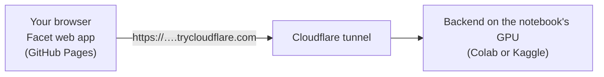

# Run the backend on a free GPU (Colab or Kaggle)

This guide is for someone who has never done this before. It takes about 10 minutes the first time.

## How it works, in one paragraph

The 3D reconstruction needs a strong NVIDIA graphics card (GPU). Google Colab and Kaggle both lend
you one for free, inside a notebook in your browser. The notebook downloads this project, starts
the backend server on that GPU, and opens a **tunnel**: Cloudflare gives the server a temporary
public address like `https://quiet-river-lamp.trycloudflare.com`, so the web app (which runs in
*your* browser) can send photos to it. When you stop the notebook, the GPU, the server and the
address all go away. Next time you get a new address.



## Colab or Kaggle?

| | Google Colab | Kaggle |
| --- | --- | --- |
| Account | any Google account | Kaggle account, **phone-verified** (needed to switch on internet) |
| GPU | T4, 15 GB | T4 (×2, we use one), 15 GB |
| Free allowance | varies day to day, a few hours | about 30 GPU hours a week |
| Easiest for | a quick try | demos you plan ahead, a more predictable quota |

Both work the same way with the same notebook.

## Option A: Google Colab

1. Open the notebook:
   [](https://colab.research.google.com/github/Kareemwafaa/Image-to-3D-mesh/blob/main/notebooks/facet_backend.ipynb)
2. Sign in with your Google account if asked.
3. Menu **Runtime → Change runtime type**, pick **T4 GPU**, click **Save**.
4. Menu **Runtime → Run all**. If Colab warns that the notebook is not authored by Google, click
   **Run anyway**.
5. Wait. The last cell prints a box like this when the model is loaded (5 to 10 minutes the first
   time):

   ```
   ========================================================================
     Facet backend is ready

     Public API URL   https://quiet-river-lamp.trycloudflare.com

     Open the app, already connected:
     https://kareemwafaa.github.io/Image-to-3D-mesh/?api=https%3A%2F%2F...
   ========================================================================
   ```
6. Click the **Open the app** link. The top-right corner of the app should say **Server ready**.
7. Leave the Colab tab open while you use the app. When you're done, click the **■** (stop) button
   on the last cell, then **Runtime → Disconnect and delete runtime** to give the GPU back.

## Option B: Kaggle

1. Make a Kaggle account at [kaggle.com](https://www.kaggle.com) and verify your phone number
   (profile → **Settings** → **Phone verification**). Without it, Kaggle notebooks have no internet.
2. Open the notebook:
   [](https://kaggle.com/kernels/welcome?src=https://github.com/Kareemwafaa/Image-to-3D-mesh/blob/main/notebooks/facet_backend.ipynb)
3. In the right-hand panel (click **›** or the settings icon if it's hidden):
   - **Session options → Accelerator → GPU T4 x2**. Don't pick P100; it is much slower at the
     half-precision maths the diffusion model uses.
   - **Internet → On**.
4. Click **Run all** at the top.
5. Wait for the box with **Facet backend is ready** in the last cell's output, then click the
   **Open the app** link.
6. When you're done, click **■** (stop) and then the power icon (**Stop session**), so you don't
   burn your weekly GPU hours.

> Tip for demos: Kaggle lets you *Save* a copy of the notebook to your account. Next time, open your
> copy and click Run all.

## Using the app with your server

- The **Open the app** link puts your server address into the app automatically (`?api=...`).
- Or open the app yourself, click **Server offline / Server ready** in the top-right corner, paste
  the **Public API URL** and click **Connect**.
- The app remembers the address in your browser. When you start a new session you get a new address,
  so connect again.

## How long does a model take?

**Estimates, not yet measured on a T4.** For one object at the default settings:

| Stage | What happens | Estimated time on a T4 |
| --- | --- | --- |
| First start only | download ~5 GB of model weights, load them | 3 to 6 min |
| Segmentation | U²-Net background removal (CPU) | ~1 s |
| Multi-view diffusion | Zero123++, 75 denoising steps at 960×640, fp16 | 1 to 2 min |
| Reconstruction | NeuS fit, 2,500 steps of 1,024 rays | 2 to 4 min |
| Meshing | marching cubes at 256³, colours, export | 10 to 30 s |

**Memory (estimated):** about 4 GB of fp16 diffusion weights plus a few GB of activations during
diffusion, and 1 to 3 GB for the reconstruction. That fits the T4's 15 GB with room to spare, so
both models stay loaded between jobs.

For a faster demo, set fewer steps before starting the server, for example by adding this line at
the top of the last cell: `%env DIFFUSION_STEPS=40` and `%env RECON_ITERS=1500`. (The Zero123++
authors note that around 28 steps already give usable views.)

## Troubleshooting

| What you see | What to do |
| --- | --- |
| `No GPU found` | Turn on the GPU (Colab: Runtime → Change runtime type; Kaggle: Accelerator), then Run all again. |
| `Could not open a Cloudflare tunnel` | Kaggle: switch Internet on (needs phone verification). Then run the last cell again. |
| App says **Server offline** | The last cell has to keep running. If you restarted it, the address changed: use the new link. |
| App says the server doesn't answer, but the cell is running | Wait until the cell prints **Facet backend is ready**; the model may still be loading. |
| `CUDA out of memory` | Make sure only this notebook uses the GPU. Restart the session and run again. |
| Colab disconnects after a while | Free Colab stops idle sessions. Keep the tab open and use it; or use Kaggle. |

## Is this safe and allowed?

- The tunnel address is random and only lives as long as your session. Anyone who has the link can
  send photos to your server while it runs, so share it only for demos.
- Photos and meshes are stored on the notebook's temporary disk and disappear with the session.
- Read Colab's and Kaggle's terms for what free GPUs may be used for. A short, interactive demo of
  your own project is the kind of use they are meant for.
